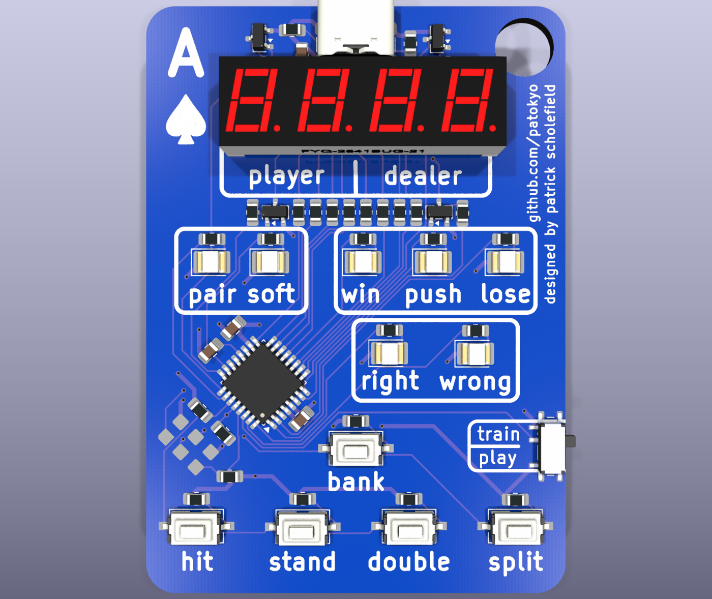
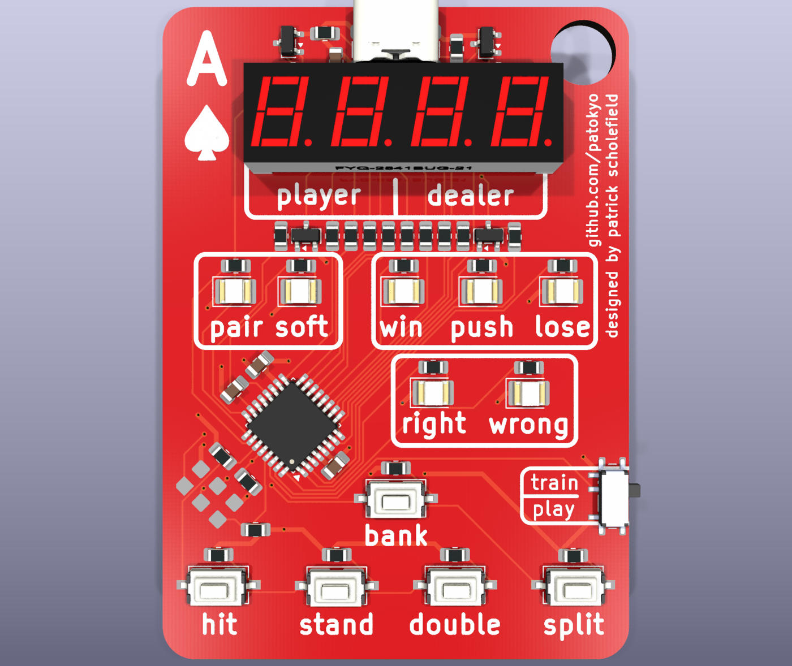
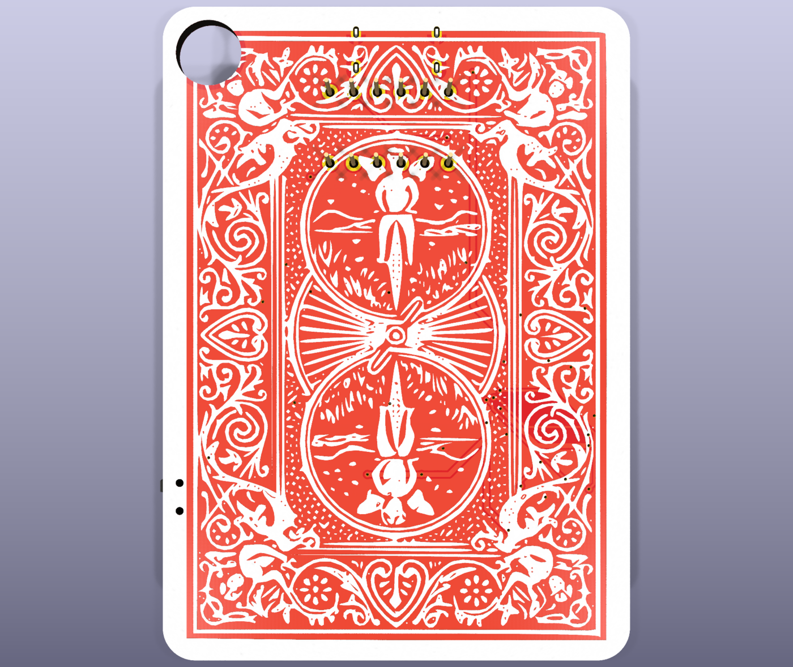

<div align="center">

# Blackjack Keychain

**A credit-card-sized blackjack basic-strategy trainer**

50 × 70 mm · ATmega328P · USB-C · 0.28" four-digit display

| | Blue solder mask | Red solder mask |
|:--:|:--:|:--:|
| Front |  |  |
| Back |  |  |

</div>

A pocket-sized trainer for blackjack basic strategy. An ATmega328P deals
from a six-deck shoe, you answer each decision with the five on-board
buttons, and the firmware marks the answer against basic strategy before
playing the hand out. In train mode it keeps score; in play mode it keeps
a bankroll in EEPROM between sessions.

*Both sides rendered from the board file in `hardware/` with KiCad's 3D
renderer. The board carries no stackup colours of its own, so set the top
and bottom solder-mask colours under Board Setup → Physical Stackup before
running `kicad-cli pcb render` to reproduce these.*

## What it does

- **Play mode** — a $100 bankroll, a bet you set before every hand from $5
  to $100, and the bank carried over in EEPROM after every hand. A bank
  under $5 goes on the next hand whole; only an empty bank ends the run.
  Reach $9999 and the board throws a party.
- **Train mode** — the same hands with no money. Every decision is graded,
  a wrong answer shows the play the book wanted, and the bank button
  reports your running accuracy.

Both modes share the same rules: six decks, dealer stands on soft 17,
double on any first two cards, double after split, up to four hands by
splitting, no resplitting aces, split aces get one card only, and a
two-card 21 is a natural that beats a made 21.

## Hardware

| | |
|---|---|
| Board | 50 × 70 mm, 2 layers, 1.6 mm FR4, 3.5 mm corner radius, 7 mm keyring hole |
| MCU | ATmega328P-AU, TQFP-32, 5 V, internal 8 MHz RC oscillator, no crystal |
| Power | USB-C power-only receptacle, 5.1 kΩ CC pull-downs, no USB-serial chip |
| Display | 0.28" four-digit common cathode, one NPN low-side switch per digit |
| Indicators | 7 LEDs: pair, soft, win, push, lose, correct, wrong |
| Input | 5 tactile buttons on two resistor ladders, plus SW6 as a slide switch |
| Programming | 2×03 ISP pads on the front of the board |
| Decoupling | 2 × 100 nF on +5 V, 100 nF on AREF, 10 µF bulk |

There is no USB-serial converter, so the ISP pads are the only way to
program an assembled board. The five buttons are the only input; the
slide switch chooses the mode.

### Pin map

TQFP pad, port bit, and the Arduino name used by the sketch:

| Function | Pin | Pad |
|---|---|---|
| Correct LED | D2 (PD2) | 32 |
| Wrong LED | D1 (PD1) | 31 |
| Lose LED | D3 (PD3) | 1 |
| Digit 4, Q4 | D4 (PD4) | 2 |
| Push LED | PB6 | 7 |
| Digit 2, Q2 | PB7 | 8 |
| Segment b | D5 (PD5) | 9 |
| Segment g | D6 (PD6) | 10 |
| Segment c | D7 (PD7) | 11 |
| Win LED | D8 (PB0) | 12 |
| Segment dp | D9 (PB1) | 13 |
| Segment f | D10 (PB2) | 14 |
| Segment d | D11 (PB3) | 15 |
| Segment a | D12 (PB4) | 16 |
| Segment e | D13 (PB5) | 17 |
| Soft LED | A0 (PC0) | 23 |
| Digit 3, Q3 | A1 (PC1) | 24 |
| Digit 1, Q1 | A2 (PC2) | 25 |
| Pair LED | A3 (PC3) | 26 |
| Ladder 1: hit / stand / double | A4 (PC4) | 27 |
| Ladder 2: split / bank | A5 (PC5) | 28 |
| RESET | PC6 | 29 |
| Mode switch | D0 (PD0) | 30 |

Three consequences are worth knowing before flashing:

- **PB6 and PB7 have no Arduino number** on a 328P, because a normal board
  spends them on the crystal. This one runs from its internal oscillator,
  so they are free, but they can only be reached through `PORTB`.
- **PD1 is also UART TX**, and it drives the wrong LED. The sketch has no
  serial code, but anything you add will flicker that LED.
- **PB3, PB4 and PB5 are the ISP pins** and also drive segments d, a and
  e, so the display is connected while the board is programmed. This works,
  but do not add a series part on those nets.

### Input ladders

Each button pulls its ladder pin up through its own resistor against a
10 kΩ pull-down, and the ADC reference is the same +5 V rail, so the
readings are ratiometric:

| Button | Resistor | ADC count |
|---|---|---|
| Hit | 1 kΩ | ≈ 930 |
| Split | 2.2 kΩ | ≈ 839 |
| Stand | 3.3 kΩ | ≈ 769 |
| Double / bank | 6.8 kΩ | ≈ 609 |
| Nothing pressed | — | ≈ 0 |

Press one button per ladder at a time: two at once put their resistors in
parallel and land on a level that means neither button.

## Firmware

Open `firmware/blackjack-keychain/blackjack-keychain.ino` in the Arduino
IDE. The folder name matches the sketch name, as the IDE requires.

- Use **MiniCore** with the ATmega328 and **8 MHz internal** clock, so
  `F_CPU = 8000000L`.
- Low fuse **`0xE2`**, with CKDIV8 unprogrammed. A part straight from the
  factory divides the internal oscillator down to 1 MHz, which plays the
  game eight times too slowly.
- Burn the chip with no bootloader and program it through J2 with an ISP
  programmer.

The mode switch is read all through a hand: flipping it mid-hand drops that
hand, void, and switches straight away, with PLAY or TRN on the display as
the switch lands. Play is +5 V, train is GND.

### Controls

| Button | Ladder | Action |
|---|---|---|
| SW1 | A4, 1 kΩ | Hit |
| SW2 | A4, 3.3 kΩ | Stand |
| SW3 | A4, 6.8 kΩ | Double |
| SW4 | A5, 2.2 kΩ | Split |
| SW5 | A5, 6.8 kΩ | Bank: tap to deal the hand at the bet prompt; hold for the bankroll or accuracy, hold longer for HIGH and the best bank |
| SW6 | D0 | Play (+5 V) / train (GND) |

Before every hand the same four action buttons set the bet, with BET on the
display first: hit adds $5, stand takes $5 off, double doubles it, split
halves it, and a tap of the bank button deals.

A decision the hand cannot make — a double after a hit, or a split the
bankroll cannot cover — blinks the display and is not graded.

### Nano build

`firmware/nano-blackjack/` is the same game on an Arduino Nano, with the
parts on a breadboard. Its pin map is different: the ladders move to A6
and A7, the correct and wrong LEDs are dropped, and the mode switch goes
on A5, the one pin left over, as an SPDT with its common to A5, one throw
to +5 V (play) and the other to ground (train). Nothing else changes
mode: a build with no switch fitted leaves A5 to its internal pull-up and
so stays in play. See the header of that sketch for the breadboard
wiring.

The game it plays is the keychain's, line for line: same bet prompt, same
$5 to $100 range, same grading and the same EEPROM layout. Train mode has
no bank on either build, so there every hand is a flat $10.

`firmware/nano-display-test/` is a wiring check for the display alone: it
lights each digit, each segment and each decimal point in turn, then
counts 0000 to 9999.

## The virtual board

`virtual/` is a browser version of the same game, drawn on the real board
art. The copper, pads, silkscreen and part outlines are plotted from the
gerbers in `hardware/fabrication`, so the picture matches the physical
board.

```sh
python3 -m http.server 8000
# then open http://localhost:8000/virtual/
```

`H`, `S`, `D` and `P` play, and before each hand in play mode they set the
bet: `H` adds $5, `S` takes $5 off, `D` doubles it, `P` halves it. A tap of
`B` deals the hand and a hold on it shows the bankroll. `T` (or the slide
switch) changes mode, and moving it mid-hand drops that hand the way the
boards do. The blue/red swatches below the board switch the solder-mask
colour.

After re-plotting the fabrication outputs, regenerate the board art with:

```sh
python3 virtual/make_board.py
```

## Repository layout

```
hardware/
  blackjack-keychain.kicad_pro      KiCad 10 project
  blackjack-keychain.kicad_sch      schematic, single sheet
  blackjack-keychain.kicad_pcb      board, 2 layers
  blackjack-keychain.net            netlist export (stale — see below)
  fp-lib-table                      project footprint library table
  custom_footprint_library.pretty/  display footprint and ISP pads
  3dmodels/                         display and slide-switch STEP models
  fabrication/                      gerbers, drills, job file, BOM, fab zip
firmware/
  blackjack-keychain/               the sketch
  nano-blackjack/                   the same game on a Nano
  nano-display-test/                display wiring check on a Nano
virtual/
  index.html                        the board in a browser
  game.js, ui.js                    game engine, display and controls
  board-blue.svg, board-red.svg     generated board art
  make_board.py                     plots the board art from fabrication/
docs/
  board-blue.png, board-red.png            front renders
  board-blue-back.png, board-red-back.png  back renders
  instruction-booklet.txt                  the page-by-page outline the booklet follows
  instruction-booklet.html                 printable booklet, 8 pages at 50 × 70 mm
  instruction-booklet.pdf                  the same, imposed on one A4 sheet for duplex
  card-pack-box.html                       printable tuck box for the board and booklet
  card-pack-box.pdf                        the same, one A4 side, cut and glued
```

The KiCad project, its netlist and its outputs stay together under
`hardware/` so the project opens with everything it needs in one place.
`hardware/fabrication/` holds the last set of outputs sent to a board
house; regenerating them means re-plotting from KiCad, not editing them
by hand.

## Fabrication

Plot with the layer set currently committed: F.Cu, B.Cu, F.Paste, B.Paste,
F.Silkscreen, B.Silkscreen, F.Mask, B.Mask, Edge.Cuts, plus the PTH and
NPTH drill files. `hardware/fabrication/blackjack-keychain.zip` is the
last archive sent out.

The images at the top of this file were rendered with KiCad 10:

```sh
kicad-cli pcb render --side top --quality high --perspective \
  --use-board-stackup-colors --background opaque -o board.png \
  hardware/blackjack-keychain.kicad_pcb
```

## Known issues

- **The BOM names the wrong display.** `hardware/fabrication/blackjack-keychain.csv`
  (and the schematic value) says `CC56-12EWA`, which is a 0.56" part with a
  50.3 × 19 mm body. The footprint and the 3D model are a 0.28" 12-pin module
  on 2.54 mm pitch (3461AS-style pinout), so order a 0.28" common-cathode part,
  not a CC56.
- **The BOM's capacitor footprint is stale.** C1–C4 are listed as 1206
  (`C_1206_3216Metric`) but the board pads are 0805 (`C_0805_2012Metric`).
  Order 0805 parts.
- **`hardware/blackjack-keychain.net` is older than the board.** It does not
  show the two VCC pins or the decoupling capacitors, and several pin nets
  differ from the PCB. Re-export the netlist from KiCad before using it.
